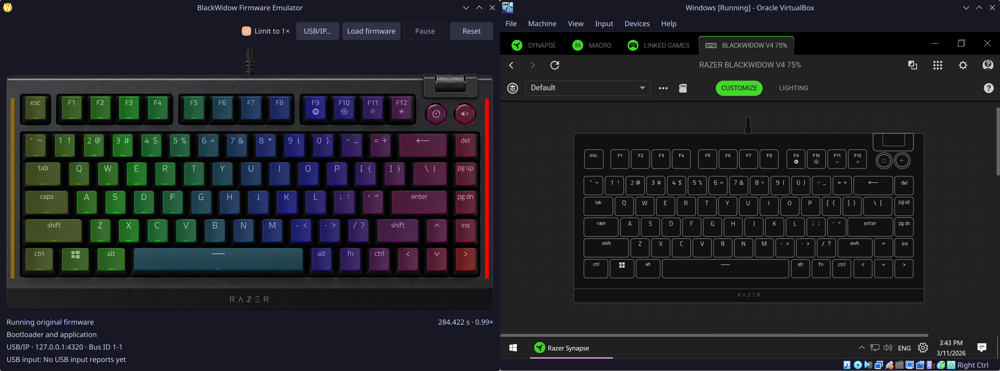

# Razer BlackWidow V4 75% Emulator

Run the original BlackWidow V4 75% firmware on a virtual keyboard. The
emulator models the LPC5528 microcontroller and keyboard hardware in Renode.
The firmware scans the keys, drives the LEDs, and responds to USB requests.



## What you can do

- Click the pictured ANSI keys and media buttons. Left-click for a momentary
  press or right-click to hold a key until you right-click it again. Click
  the top or bottom half of the roller for volume up or down.
- See firmware-driven RGB for the keys and the 18 side underglow zones.
- Run an application image, cold-boot with the original bootloader, or load a
  complete flash image in the GUI.
- Export the virtual keyboard over USB/IP to test guest software. VirtualBox
  and QEMU guests have been used with Razer Synapse.
- Use the headless CLI for USB enumeration, scripted inputs, and execution
  diagnostics, or embed the Python core in your own frontend.

## Get started

You need Python 3.11 or newer, a .NET build of Renode 1.17.0 with a compatible
.NET runtime, and your own firmware. The GUI uses PySide6 and Qt Quick.

From the repository root on NixOS:

```sh
nix-shell
python -m razer_emu_gui
```

The shell supplies Renode, Python, PySide6 and the Renode bridge. For a
regular Python installation, use a virtual environment with Renode and its
runtime installed:

```sh
python -m venv .venv
. .venv/bin/activate
python -m pip install '.[gui]'
razer-emu-gui
```

The Python bridge is pinned to a Git revision, so installation requires Git.
Set `PYRENODE_PATH` to the Renode installation directory if the bridge cannot
find it. Set `DOTNET_ROOT` to the compatible runtime if needed.

### Load firmware

The **Load firmware** menu accepts three forms.

| Mode | Files |
| --- | --- |
| Application only | A raw SRAM-linked application binary with its vector table |
| Bootloader and application | A raw 32 KiB bootloader and a separate application binary |
| Complete flash image | A raw 512 KiB image with the bootloader at offset zero and the application at `0x8000` |

Application versions **1.1.1** and **1.2.1** have been tested. The UI uses the
ANSI hardware map. Other versions for the same board can be tried directly.
Firmware is supplied separately. Obtain it one of two ways:

- Dump an existing BlackWidow V4 75% with
  [razer-fwdump](https://github.com/hacker1024-slop/razer-fwdump). Load the
  dumped application by itself in **Application only** mode. To run the
  original boot sequence, also load the bootloader or use a complete flash image.
- Download an official Razer firmware updater and extract its application
  binary with [razer-fwdl](https://github.com/hacker1024-slop/razer-fwdl).
  Use the extracted binary for application-only mode.

For separate images, the GUI supplies blank settings so the tested firmware
can initialize defaults. Verified region captures supplied with
`--flash-dump DIRECTORY` override those bytes. Complete images carry their
own settings. Treat flash captures as private because they can contain
device identifiers, profiles, and macros.

```sh
python -m razer_emu_gui application.bin
python -m razer_emu_gui application.bin --bootloader-dump bootloader.bin
python -m razer_emu_gui --full-image flash.bin
```

**Reset → Normal startup** reboots the keyboard. With a bootloader loaded,
**Reset → Bootloader mode** holds the emulated Fn contact at startup and
enters Razer update mode. The GUI shows virtual time and measured speed.
**Limit to 1×** is on by default. Actual speed and animation smoothness depend
on the host and workload, especially when Synapse streams lighting.

### Connect a virtual machine

Open **USB/IP…**, enable export, and select a port. The default endpoint is
`127.0.0.1:3240` with bus ID `1-1`. You can also launch with
`python -m razer_emu_gui application.bin --usbip 3240`.

In VirtualBox, register the host’s native USB/IP source and attach the
exported keyboard from the VM’s USB menu:

```sh
VBoxManage usbdevsource add razer-emulator --backend USBIP --address 127.0.0.1:3240
```

A QEMU guest using user-mode networking can use a USB/IP client to attach
bus ID `1-1` at `10.0.2.2`, the default host address for that network mode.
Use the Linux USB/IP client or a Windows client such as
[usbip-win2](https://github.com/vadimgrn/usbip-win2).

Resetting or changing the export settings disconnects an attached guest.
Reattach after the keyboard comes back. Firmware can also re-enumerate under
a different USB identity when it enters update mode. The listener binds to
loopback and USB/IP has no authentication.

## CLI and library

Use `razer-emu` after installing the package or run `python -m razer_emu_cli`
from the source tree. A headless run reports diagnostics as JSON. Use
`--flash-dump DIRECTORY` for verified settings regions if the application
needs them. The headless CLI does not synthesize the GUI’s blank settings.

```sh
python -m razer_emu_cli application.bin --microseconds 20000
python -m razer_emu_cli application.bin --flash-dump settings-capture --usb-enumerate
python -m razer_emu_cli application.bin --bootloader-dump bootloader.bin --bootloader-mode
python -m razer_emu_cli application.bin --flash-dump settings-capture --usbip 3240
```

Run `python -m razer_emu_cli --help` for input scripts, lighting controllers,
and timing options. The reusable entry point is `razer_emu.core.Keyboard`.
Create one keyboard per process and call it from its owning thread.

```python
from razer_emu import Firmware
from razer_emu.core import Keyboard

with Keyboard(Firmware.load("application.bin")) as keyboard:
    print(keyboard.run_for(1_000).to_dict())
```

## Scope

This is an unofficial, experimental emulator for one keyboard model. USB
enumeration, input, lighting, bootloader entry, and representative Synapse
operations have been exercised. Firmware and guest software compatibility
vary. By default the virtual flash can inject an unreadable page after an
attempt to program it without erasing. This models a possible ECC failure
for recovery testing. Use `--no-simulate-overprogram-ecc-fault` to opt out.

See the [hardware model notes](docs/model-notes.md) and
[GUI mapping notes](docs/gui-mappings.md) for implementation details.

## Development

Run `python -m pytest` for the standard tests. Run
`python -m pytest --run-engine` with Renode and GNU Arm binutils installed for
integration tests. Set `RAZER_TEST_FIRMWARE` and, where needed,
`RAZER_TEST_BOOTLOADER_DUMP` or `RAZER_TEST_FLASH_DUMPS` to exercise private
images.

The emulator code is available under the [MIT license](LICENSE). The GUI
uses an AI-generated keyboard illustration.
